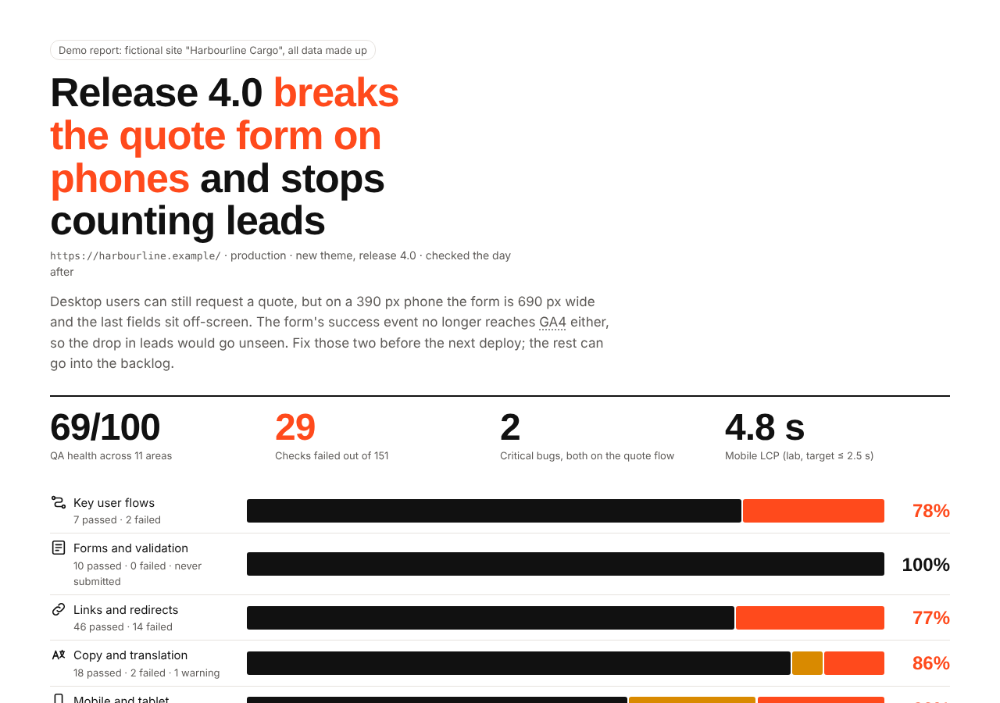
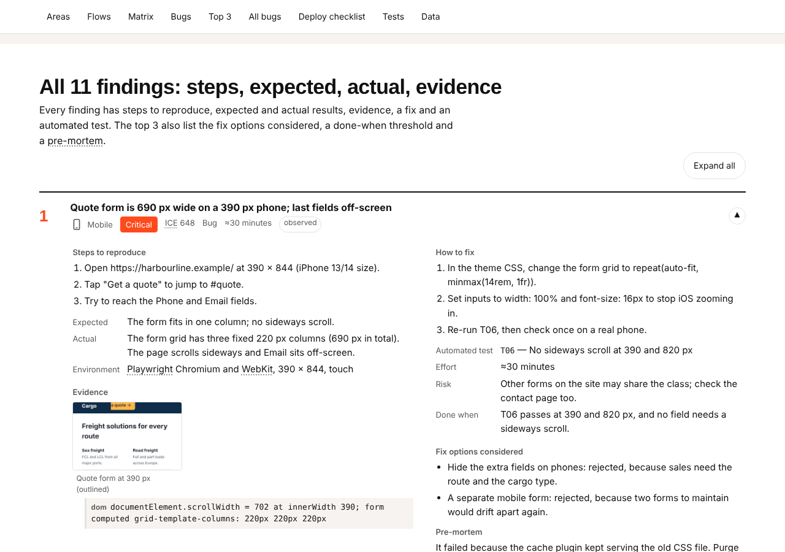
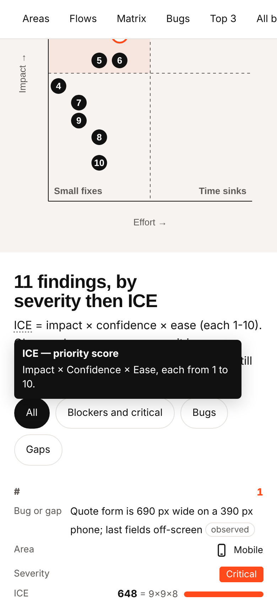

# QA Audit

A Claude skill that QA-tests a live website after a deploy or redesign and hands back four things:

1. **A visual report for people**: a release verdict, checks passed vs failed in each of 11 areas, the flows that break, and a ranked bug list.
2. **A bug list** with steps to reproduce, expected and actual results, environment, and screenshot or log evidence for each bug.
3. **A hand-off file for AI agents** (`qa-handoff.md`): the same bugs as plain tasks with exact locations, fix code, who has to act and the test that proves each fix, ready to give to Claude Code, Cursor or Codex. [Example](docs/example-qa-handoff.md).
4. **Deterministic Playwright tests** to rerun after every deploy. They never submit forms and never send events to your analytics.

**Live demo:** [English report](https://claude.ai/artifact/4mXJrvNQ9Mb5NGobzLibgs) (fictional site "Harbourline Cargo", made-up data).

The report has the same design as [product-lens-audit](https://github.com/artemhorbenko/product-lens-audit): annual-report look, light and dark themes, a tooltip for every term, and stacked tables on phones. This skill covers QA only; strategy and growth belong to product-lens-audit.



### The 11 QA areas

| Group | Area | What it checks |
|---|---|---|
| Works | **Key user flows** | Home → service → CTA → form → "sent"; every CTA target exists |
| | **Forms and validation** | Required fields, types, labels, messages, legacy forms. **Stops before submit** |
| | **Links and redirects** | Internal links, old → new URLs (301, one hop), language redirects. Crawls politely |
| Looks right | **Copy and translation** | Copy-paste errors in cards, wrong-language buttons and menus, empty pages, missing meta |
| | **Mobile and tablet** | 390 / 820 px: no sideways scroll, usable menu and form, tap targets |
| | **Cross-browser** | Chromium, Firefox and WebKit (Safari) |
| Technically healthy | **Console and network** | JS errors, failed requests |
| | **Performance** | PageSpeed Insights: LCP, CLS, TBT/INP, heavy hero images |
| | **Accessibility** | axe / Lighthouse: contrast, labels, names, keyboard |
| Measured | **Analytics and events** | GA4 tag on every template, key events (form sent, tel:/mailto: clicks), no double counting |
| | **Post-deploy checklist** | Tag, events, redirects, forms, texts, languages, sitemap, console, speed |

## What you get

- **The verdict first**: blocks release / fix before next deploy / fix in backlog / ready.
- **Checks passed vs failed by area** as the header picture. Areas that could not be checked are hatched, not guessed.
- **Findings labelled observed or hypothesis**, sorted by severity and then ICE. Each one has steps, expected, actual, environment, evidence, a fix that names the real plugin and setting, and its test.
- **Top 3 fixes** with the fix options considered, a done-when threshold and a pre-mortem.
- **A post-deploy checklist** and **a tests table** with the command to run them.
- **Honest confidence**: which tools were used and which were missing.
- **A hand-off for the coding agent**: YAML front matter (site, verdict, stack, not-checked areas) and tasks grouped by owner: *agent can do it in code*, *needs admin access* (CMS, GTM, GA4, hosting), *needs the owner's decision*. Each task has location, steps, expected and actual results, evidence, a fix with a code block, the done-when line and its `QA_ONLY=T07 npx playwright test` command.

<p>


</p>

## How it works

1. **Checks the tools**: browser (Claude in Chrome, built-in or cloud), headless Playwright, PageSpeed Insights, a CMS connector, GA4. Each is marked used, partial or missing.
2. **Asks up to 4 skippable questions**: what changed, the key flows, access, known issues. A detailed brief counts as the answers.
3. **Runs the checks** area by area. For analytics, it wraps `dataLayer.push`, blocks analytics requests, and fires the form's success event (`wpcf7mailsent`, Gravity Forms' `gform_confirmation_loaded`) in the browser, so nothing is sent to the server and no fake lead reaches GA4. It then closes the loop: it parses the published GTM container to compare triggers with what the page pushes, reads GA4 key events and counts, and reads Search Console's 5xx, 404 and robots reports (all read only).
4. **Writes findings** with evidence, sets the verdict, and ranks them by severity × ICE.
5. **Writes the test suite**: one check that fails today for each bug, plus regression checks.
6. **Writes `audit.json` only.** Then it validates the data (`validate_audit.py`), builds the page, the hand-off and the tests (`build_report.py`), render-checks the page on desktop, tablet and phone (`check_report.py`), and fact-checks every number.

### Safety rules

- Never submits real forms, payments, sign-ups or messages, and does not open tel:/mailto: links.
- Never sends synthetic events into production analytics: analytics and ad requests are blocked during checks and in every generated test.
- Crawls politely: one request at a time, at least 1 s apart, about 60 pages at most. It stops on 429, 503 or a captcha, never solves the captcha, and never reports the 429/503 errors its own crawl caused as broken links.
- Connected sources are used read-only.

## Rerun the tests after every deploy

The report ships with a `qa-tests/` folder: a generic runner (`qa.spec.js`) plus your site's checks in `qa-suite.json`.

```
cd qa-tests
npm install
npx playwright install chromium
npx playwright test                 # after every deploy
BROWSERS=all npx playwright test    # + Firefox and WebKit
QA_ONLY=T04,T05 npx playwright test # some checks only
```

Check types: `status`, `redirect`, `ga4_tag`, `tag_present`, `click_event`, `form_event`, `form_fields`, `text`, `no_text`, `ui_language`, `console_clean`, `no_h_scroll`, `page_links`, `sitemap`, `robots_disallow`, `axe`, `meta`. If the host rate-limits or shows a captcha, the check is skipped as "not checked" rather than failed. See [references/test-suite.md](plugins/qa-audit/skills/qa-audit/references/test-suite.md).

The checks are data, so the same runner can serve many sites (for example a QA service for WordPress sites that runs one `qa-suite.json` per site from a deploy hook).

## Install

### Claude Code (terminal, desktop app, VS Code)

```
/plugin marketplace add artemhorbenko/qa-audit
/plugin install qa-audit@qa-audit
```

Then ask, for example: *"QA example.com after yesterday's deploy; the key flow is the quote form"*.

### Claude app (claude.ai, desktop, mobile)

1. Download `qa-audit-skill.zip` from this repository ([direct download](https://github.com/artemhorbenko/qa-audit/raw/main/qa-audit-skill.zip)).
2. Turn on code execution (Settings → Capabilities).
3. Go to **Customize → Skills**, click **+**, choose **Create skill → Upload a skill**, and pick the ZIP.

For live sites, also connect a browser (Claude in Chrome). See [Use skills in Claude](https://support.claude.com/en/articles/12512180-use-skills-in-claude).

### Any other agent that reads SKILL.md

Copy `plugins/qa-audit/skills/qa-audit/` into your agent's skills folder.

## Build and check a report yourself

```
S=plugins/qa-audit/skills/qa-audit
python $S/scripts/validate_audit.py audit.json
python $S/scripts/build_report.py audit.json out/index.html     # also writes out/qa-handoff.md and out/qa-tests/
pip install playwright && playwright install chromium
python $S/scripts/check_report.py out/index.html --out ./report-check
```

Start from `$S/assets/example-audit.en.json`. The data shape is in `$S/references/audit.schema.json`.

## Repository layout

```
.claude-plugin/marketplace.json
plugins/qa-audit/
  .claude-plugin/plugin.json
  skills/qa-audit/
    SKILL.md                         the process and safety rules
    references/areas.md              the 11 areas, counting, scoring, severity
    references/data-sources.md       tools, recipes, politeness
    references/test-suite.md         check types of the test runner
    references/report-spec.md        report sections and data shapes
    references/handoff-spec.md       the hand-off file for AI agents
    references/audit.schema.json     shape of audit.json
    assets/report-template.html      the report page; renders from one JSON block
    assets/example-audit.en.json     demo data (fictional), with assets/shots/
    assets/qa-tests/                 generic Playwright runner, config, README
    scripts/validate_audit.py        data and rule check
    scripts/build_report.py          audit.json -> report + evidence + hand-off + tests
    scripts/build_handoff.py         audit.json -> qa-handoff.md only
    scripts/make_tests.py            audit.json -> qa-tests/ only
    scripts/check_report.py          headless render check
evals/                               scenarios, trigger prompts, results log, runner fixture
docs/                                screenshots, example hand-off
qa-audit-skill.zip                   the skill packaged for the Claude app
```

## Roadmap

See [ROADMAP.md](ROADMAP.md). The hand-off file for AI agents shipped in 1.1.0.

## License

MIT - see [LICENSE](LICENSE).

---

## Українською

**QA Audit** — скіл для Claude, який після деплою чи редизайну тестує живий сайт і повертає три речі:

1. **Візуальний звіт для людей**: вердикт релізу, перевірки, пройдені й не пройдені в кожній з 11 областей, зламані сценарії та пріоритизований список багів.
2. **Список багів**: кроки відтворення, очікуваний і фактичний результат, середовище, а також доказ — скріншот або лог.
3. **Hand-off для AI-агентів** (`qa-handoff.md`): ті самі баги як задачі без дизайну — точне місце, код фіксу, хто має діяти і тест, що доводить виправлення. Його можна одразу віддати Claude Code чи Cursor. [Приклад](docs/example-qa-handoff.md).
4. **Детерміновані Playwright-тести**, які можна запускати після кожного деплою. Форм вони не надсилають і подій в аналітику не шлють.

**Демо:** [звіт англійською](https://claude.ai/artifact/4mXJrvNQ9Mb5NGobzLibgs) (вигаданий сайт «Harbourline Cargo», умовні дані).

**11 областей у 4 групах:**
- **Працює:** ключові сценарії, форми й валідація (без надсилання), посилання й редіректи.
- **Виглядає:** тексти й переклади, мобільна й планшетна версії, кросбраузерність.
- **Технічно здорово:** консоль і мережа, швидкодія (PageSpeed), доступність (axe).
- **Вимірюється:** аналітика й ключові події GA4 (форма, tel:, mailto:), чекліст після деплою (тег, події, редіректи, форми, тексти, мови, sitemap).

**Правила безпеки.** Скіл не надсилає форми, оплати й повідомлення. Сайт обходить повільно, а на 429 чи капчі зупиняється. Капчі не розв'язує. Підключені джерела використовує лише для читання.

Встановлення в Claude Code:

```
/plugin marketplace add artemhorbenko/qa-audit
/plugin install qa-audit@qa-audit
```

Для Claude app завантажте ZIP ([пряме завантаження](https://github.com/artemhorbenko/qa-audit/raw/main/qa-audit-skill.zip)), потім **Customize → Skills → + → Create skill → Upload a skill**.

Запуск тестів після деплою: `cd qa-tests && npm install && npx playwright install chromium && npx playwright test`.
